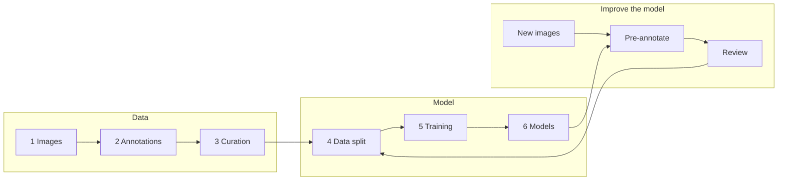

# ActiveLabel

Image datasets from curation to trained models, step by step, in a simple web interface
(English and Portuguese, light and dark theme).

A project goes from images to a trained model in six steps, in two groups: **Data** (images,
annotations, curation) and **Model** (data split, training, models). A trained model can then
pre-annotate new images, which a person reviews in CVAT or FiftyOne and feeds back into the next
training.



The current model pre-annotates new images, a person reviews them, and the reviewed images go into a new
split and a new training (the arrows from *6 Models* to *Pre-annotate*, and from *Review* to *4 Data split*).

Guia em português: [docs/GUIA.pt-BR.md](docs/GUIA.pt-BR.md). Engineering overview with diagrams:
[docs/ARCHITECTURE.md](docs/ARCHITECTURE.md). Contributing: [CONTRIBUTING.md](CONTRIBUTING.md).

**Names in the interface.** This page and the other documents quote the English interface. The
Portuguese interface has the same screens; its names are given once in parentheses where they are not
obvious (for example *Gallery* (*Galeria*)). *Task*, *Job* and *Fold* are the same word in both languages,
as in CVAT. The full list is in
[`src/activelabel/i18n/pt.json`](src/activelabel/i18n/pt.json).

## Install

Python 3.10 or newer.

```bash
python -m venv .venv
# Windows: .venv\Scripts\activate    Linux/macOS: source .venv/bin/activate
python -m pip install -e ".[dev]"
```

## Run

```bash
activelabel serve --open
```

Options of `serve`: `--host` (default `127.0.0.1`), `--port` (default `8090`) and `--open` (opens
the browser). Without activating the environment, use the launcher of the repository, which runs
the Python of the `.venv` folder next to it: `activelabel.cmd serve --open` (Windows) or
`./activelabel.sh serve --open` (Linux, macOS). The interface opens at `http://127.0.0.1:8090`.

The service has no login: keep the default host `127.0.0.1` unless you are on a trusted network.

## How it works

**New project** (not a step): name, description and **type** (classification, detection,
segmentation or keypoints). The project number is automatic. Classes are optional; they can
come from the annotation files. A project that already exists in CVAT or Label Studio can
be imported instead ([docs/IMPORT.md](docs/IMPORT.md)). The project page then shows a compact
bar with the six steps; each step shows a marker (done, needs attention, in progress) and its status.
(In ActiveLabel a *task* is a package of images, as in CVAT; the kind of
project is its *type*.)

### Data

1. **Images** has two tabs. *Gallery* (*Galeria*) is the grid of images, filtered by task and job.
   *Tasks and jobs* (*Tasks e jobs*) lists the tasks (one upload, or one video, is one task) split
   into jobs of a chosen size, as in CVAT; *New task* takes files, a folder, a .zip or a video.
   Files are stored unchanged (the kind of an image is decided by its content, not its extension),
   identical images are added once and unreadable files are listed with the reason. See [docs/TASKS.md](docs/TASKS.md) and [docs/VIDEO.md](docs/VIDEO.md).
2. **Annotations** (optional) has five tabs:
   - *Summary* (*Resumo*): what the project has, as tiles (images annotated, annotations, classes with
     annotations, to review) and the top classes, with a search and *Show all*.
   - *Pre-annotate* (*Pré-anotar*): a saved model, or a public pretrained one (COCO), suggests
     labels for the images of a task; see [docs/PREANNOTATE.md](docs/PREANNOTATE.md).
   - *CVAT*: link the project to CVAT and synchronise annotations in both directions with
     *Compare with CVAT* (*Comparar com o CVAT*), a review, and *Apply synchronisation*
     (*Aplicar a sincronização*); see [docs/ANNOTATION.md](docs/ANNOTATION.md) and
     [docs/SYNC.md](docs/SYNC.md).
   - *FiftyOne*: edit annotations in the FiftyOne App and bring them back.
   - *Import annotations* (*Importar anotações*): drop annotation files (or a .zip). The format is
     detected (COCO JSON, YOLO txt with `data.yaml`/`classes.txt`, Pascal VOC XML, CVAT for images or
     video XML, MOT, Label Studio JSON, class folders), the files are matched with the images and a
     report (which takes the place of the drop zone) shows what was found and any problem. Labels that do
     not have the shape of the project's type are reported and left out. Nothing is imported until you choose *Import*,
     *Change the type to {task} and import*, *Convert to {task} and import* (for example outlines to
     boxes) or *Discard*; when the project already has annotations you also choose *Merge* or
     *Replace*. Files made for a whole video go to a video task by frame number
     ([docs/VIDEO.md](docs/VIDEO.md)).

   Label Studio is switched off in the interface for now: only *importing a project* from it is
   offered. Its code and the CVAT edit session of the API (docs/ANNOTATION.md) are still in the repository
   but are planned for removal: for CVAT, review through the synchronisation (docs/SYNC.md).
3. **Curation**: *Analyze images* measures brightness, contrast, sharpness, size and a
   perceptual hash of each image. Filters per issue (blurry, dark, bright, low contrast, small, odd
   aspect ratio, grayscale, near duplicate) show the flagged images; *Select suggested* picks the
   ones that are probably worth excluding; select and *Exclude selected* (reversible, *Excluded*
   tab, *Restore selected*) or *Delete permanently* (asks first). The limits of each issue can be
   changed under *Thresholds* without measuring again, and *Reset analysis* forgets the
   measures, flags and near-duplicate groups (images, exclusions and annotations stay).
   *Open in FiftyOne* opens the same filter in the FiftyOne App; images tagged `exclude` there can
   be brought back with *Bring exclusions from FiftyOne*. (Corrupt files never get here: they are
   rejected when uploaded.)

### Model

4. **Data split** freezes a *dataset version*: train, validation and test parts (or K folds
   plus a test part) that keep frames of one video and near duplicates together, balanced by
   class; labels a model could not use are left out with a warning, and a version whose training or
   validation part would be empty is refused; each version card has *Train with this version*; see
   [docs/DATASETS.md](docs/DATASETS.md).
5. **Training** runs a model of the catalogue on one dataset version (transfer learning,
   fine-tuning or from scratch; single run, grid search or all folds) with live curves and
   evaluation on the test part. Classification, detection, semantic segmentation, instance
   segmentation (Mask R-CNN) and keypoints (torchvision) are available; YOLO/Ultralytics models are
   listed in the API catalogue but hidden in the interface and refused by the API until they are
   supported. Packages are installed on demand in a separate environment. See
   [docs/TRAINING.md](docs/TRAINING.md).
6. **Models** keeps the runs you save (*Save as model*): compare them, choose the current one
   (*Make current*), download the weights and export ONNX (classification and semantic
   segmentation). *Add a public model* adds a pretrained COCO model that needs no training. The
   current model pre-annotates new images (*Annotations*, *Pre-annotate*, or *Pre-annotate with this
   one* on its card) for classification, detection, keypoints and both kinds of segmentation (masks
   become polygons).

### Activities

Background jobs (analysis, uploads, synchronisation, training, export, pre-annotation) appear
in a small card in the bottom-right corner of the project page, with progress, *Stop* (*Parar*) and
*See result*. It can be minimised or closed; finished activities stay in its history. Only one
heavy process (training, export or pre-annotation) runs at a time; the others wait in a queue.

More: [docs/ARCHITECTURE.md](docs/ARCHITECTURE.md) (architecture, data model and flows),
[docs/DESIGN.md](docs/DESIGN.md) (data on disk and the HTTP API),
[docs/ASSESSMENT.md](docs/ASSESSMENT.md) (strengths, risks and a roadmap),
[docs/FUTURE-LLM.md](docs/FUTURE-LLM.md) (planned use of language models) and
[docs/GUIA.pt-BR.md](docs/GUIA.pt-BR.md) (user guide in Portuguese).

## Settings

| Variable | Default | What it does |
| --- | --- | --- |
| `ACTIVELABEL_WORKSPACE` | `~/.activelabel` | Where projects, images and annotations are stored |
| `ACTIVELABEL_LANG` | `en` | Default interface language (`en` or `pt`) |
| `ACTIVELABEL_IMPORT_ROOT` | (off) | Folder of this machine whose sub-folders may be imported by path (`POST /api/projects/{id}/images/folder`; there is no button for it in the interface) |

The address and user of CVAT are kept in `<workspace>/tools.json`; passwords and tokens only in the
system keyring.

## Development

See [docs/DEVELOPMENT.md](docs/DEVELOPMENT.md) (set-up, tests, lint, types, structure, conventions,
how the training environment and workers work) and [CONTRIBUTING.md](CONTRIBUTING.md).

```bash
pre-commit install
python -m pytest -m "not integration"   # fast tests
python -m pytest -m integration         # tests that use FiftyOne
```

Continuous integration (`.github/workflows/ci.yml`) runs ruff, mypy and the fast tests on Linux and
Windows on every push to `main` and on pull requests, plus the FiftyOne tests on Linux. macOS runs
only on demand (Actions tab, *ci*, *Run workflow*).

## License

Apache License 2.0, see [LICENSE](LICENSE).
