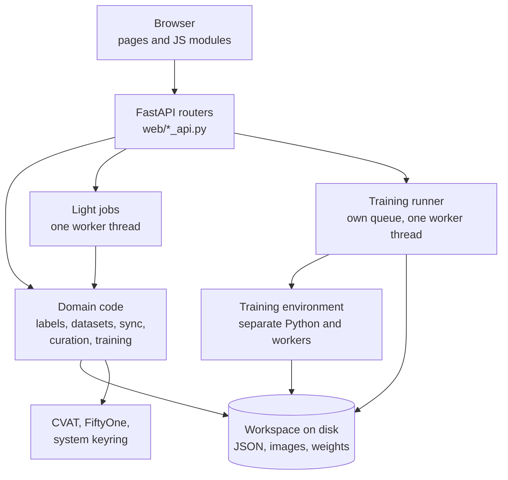
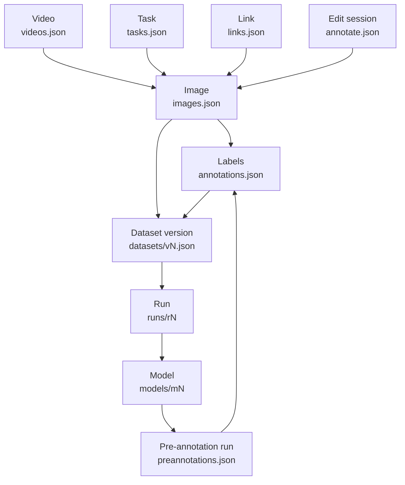
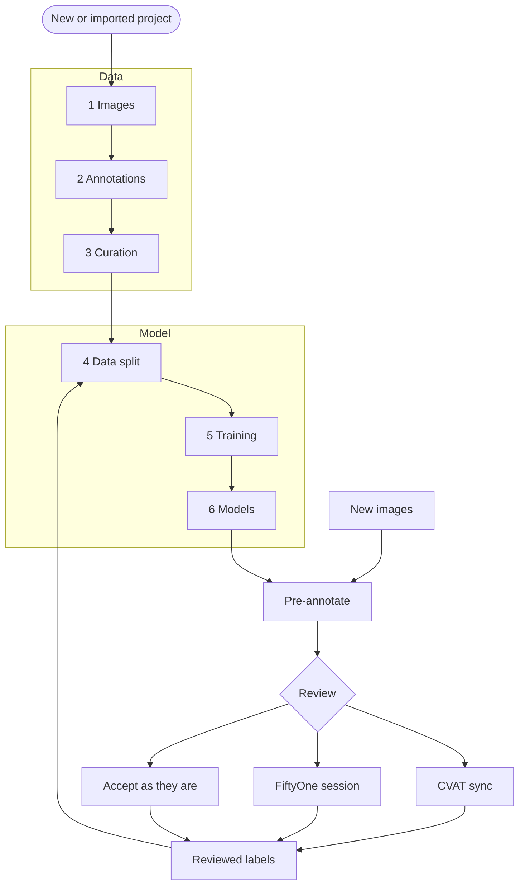
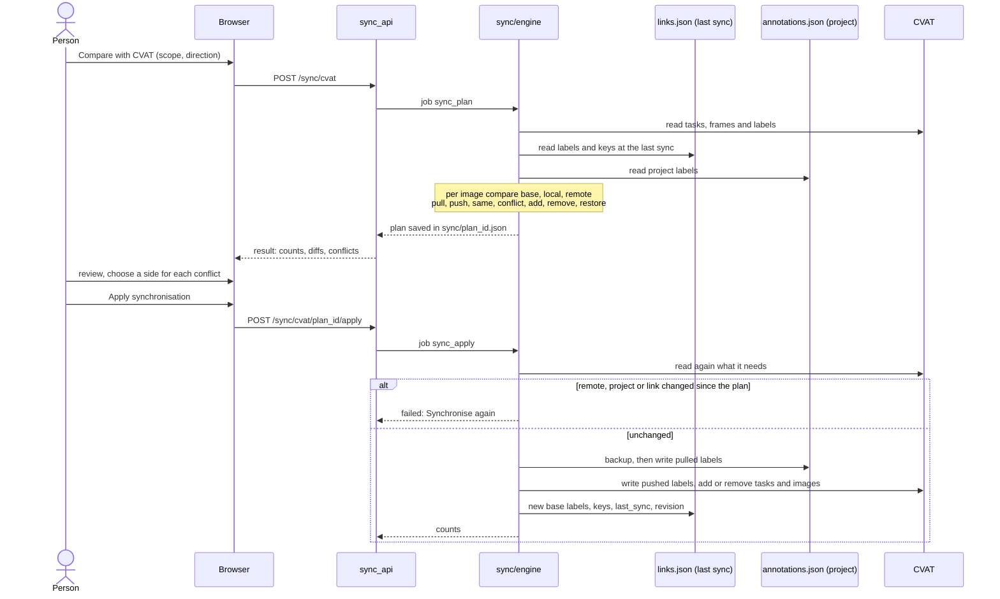
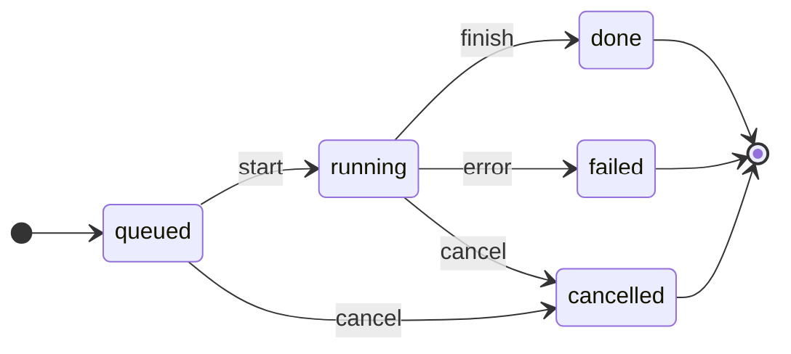
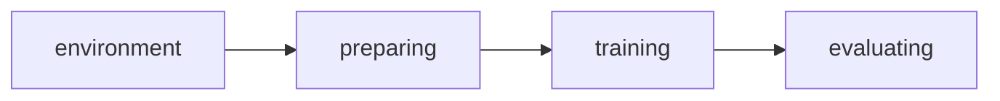
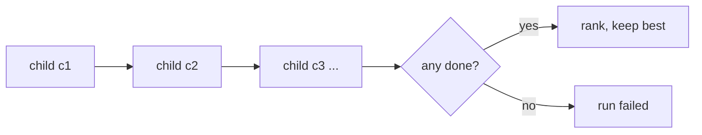
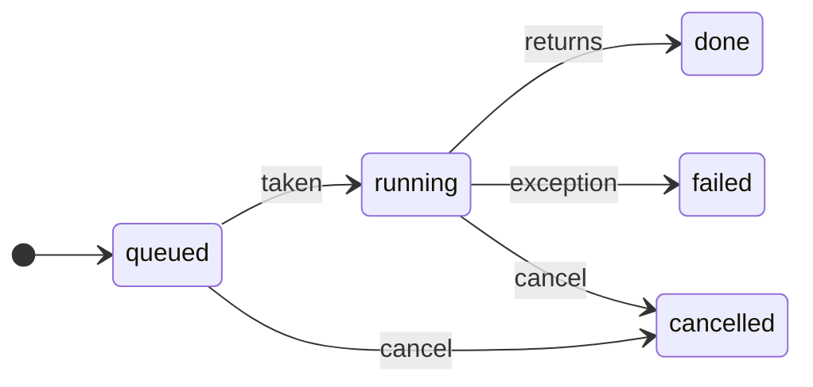

# ActiveLabel — architecture

An engineering overview with diagrams. Details of each part are in the other documents of this folder;
the strengths, weaknesses and a roadmap are in [ASSESSMENT.md](ASSESSMENT.md). The diagrams are Mermaid
and render on GitHub.

Interface names are the English ones; the Portuguese names are in `src/activelabel/i18n/pt.json`.

## 1. Components

Arrows mean "calls or uses". The browser talks to the routers over HTTP (`/api`, `/static`, pages); the
domain code reads and writes the workspace (section 2) and reaches CVAT and FiftyOne through
`sync/cvat_remote.py`, `annotate/cvat_tool.py` and `fiftyone_bridge.py`; the runner creates and fills the
training environment, starts the workers as subprocesses with a `spec.json` and reads their JSON lines.

Rules that shape the design:

- The routers hold no business logic: they validate, take the project lock/`busy` check, and call the
  domain code or submit a job.
- There is **one heavy process at a time** for the whole app (`TrainingRunner`), shared by training runs,
  ONNX exports and pre-annotation. The light `JobManager` has one worker too; `AppState.busy(project)`
  answers 409 to calls that change a project while one of its jobs is queued or running.
- Workers never import ActiveLabel: they read a `spec.json` and talk back with one JSON object per line
  (`log`, `warning`, `progress`, `epoch`, `done`, `error`; `prediction` for pre-annotation).
- Secrets live only in the system keyring; `tools.json` has addresses and user names.

## 2. Data model on disk

An arrow means "is used by" or "feeds": images come from files or from the frames of a video and are listed
by tasks; labels belong to images; a dataset version freezes images and labels; runs train on a version;
a model is saved from a run; pre-annotation runs use a model and write labels for review. A link (sync
with CVAT) and an edit session refer to images.

- Image ids are the first 16 hex digits of the SHA-256 of the file, so identical files are one image. The image keeps
  the name of its first upload; the other names it was uploaded with are kept as `aliases`, so annotation files
  that use them still match.
- A label is `{label, bbox | polygons | keypoints, score?, track?, model?}` with coordinates relative to
  the image (0 to 1). A `score` marks a pre-annotation that nobody reviewed.
- Numbers (projects, tasks, dataset versions, runs, models) are never reused.
- The folder layout and the files are listed in [DESIGN.md](DESIGN.md).

## 3. User workflow

Pre-annotations (labels with a score) are ignored by a dataset version until they are reviewed, so
the loop never trains on unchecked labels. Without any training, a public model (*Add a public model*)
can start the loop.

## 4. Synchronisation with CVAT (three-way)

The decision per image:

| Changed since the last sync | Action |
| --- | --- |
| nothing | nothing |
| only the remote | pull: remote to project |
| only the project | push: project to remote |
| both, same result | nothing |
| both, different | conflict: the person chooses |

With `direction: pull` or `push` one side wins and there are no conflicts; what exists only on the other
side is left alone and listed (docs/SYNC.md).

## 5. Training run lifecycle

While a run is `running` it goes through these phases (`phase` in `run.json`):

A run that was running when the service stopped ends as `failed` (`interrupted`) at the next start;
queued runs are queued again.

A grid search or an all-folds run is one run with **children** trained one after another in the same
slot:

If the run is cancelled, children not started are marked `cancelled`. A child that fails does not stop
the others. A run saved as a model (`models/m<N>`) hands its best weights over to the model (they move, they are not copied); ONNX export and pre-annotation
are queued in the same slot and run the same way (`queued`, `running`, `done`, `failed`).

## 6. Job lifecycle (light jobs)

A job function receives a `Progress` handle, reports with `update(...)` and calls `check()` between
steps; cancelling sets an event that `check()` turns into `Cancelled` at the next safe point.
