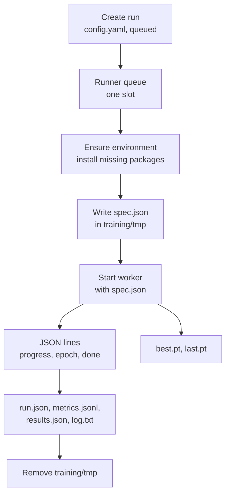

# ActiveLabel — development guide

For people who change the code. The user documentation starts at the [README](../README.md); the
architecture and flows with diagrams are in [ARCHITECTURE.md](ARCHITECTURE.md); an honest review with a
roadmap is in [ASSESSMENT.md](ASSESSMENT.md).

## Set-up

Python 3.10 or newer (CI runs 3.10 and 3.12).

```bash
git clone https://github.com/karemdm/activelabel.git
cd activelabel
python -m venv .venv
# Windows: .venv\Scripts\activate    Linux/macOS: source .venv/bin/activate
python -m pip install -e ".[dev]"
pre-commit install
```

The editable install points at the folder where you ran it. If you work in a second checkout or a git
worktree, set `PYTHONPATH` to that checkout's `src` folder before running anything, or the code of the
first checkout is used.

Run the service from your checkout with a throw-away workspace:

```bash
ACTIVELABEL_WORKSPACE=/path/to/scratch ACTIVELABEL_LANG=en activelabel serve --port 8100
```

Any free port is fine; `/docs` shows the interactive API documentation and `/openapi.json` the schema.
Never point a development server at a workspace that holds data you care about.

## Checks

| What | Command |
| --- | --- |
| Lint, docstrings, annotations | `python -m ruff check .` |
| Format | `python -m ruff format .` (CI runs `--check`) |
| Types | `python -m mypy` (reads `src`; function signatures must be typed) |
| Fast tests | `python -m pytest -q -m "not integration"` |
| FiftyOne tests | `python -m pytest -q -m integration` (starts a database of the tests' own; slow) |
| One file | `python -m pytest tests/activelabel/test_datasets.py -q` |

`pre-commit` runs the file hygiene hooks, ruff, mypy and the fast tests on every commit. Run the checks that cover what you changed
before you commit, and the whole suite before you open a pull request.

CI (`.github/workflows/ci.yml`) runs on every pull request and on `main`:

| Job | What | Required to merge |
| --- | --- | --- |
| `checks (<system>, Python <version>)` | ruff, format check, mypy, the fast tests with coverage (at least 80 %) and the command line, from a checkout and a temporary folder whose paths have accents and spaces; Linux and Windows with Python 3.12, Linux with 3.10 (the oldest supported); macOS (Apple silicon) with 3.12 only after a merge to `main` (and by hand) | yes, except macOS |
| `FiftyOne tests` | the tests marked `integration`, against a MongoDB service of the job | yes |
| `package` | builds the wheel, checks its version and files, installs it in a clean environment and fetches the pages of the installed server | yes |
| `training workers (torch CPU)` | the worker and metric tests with the pinned CPU build of PyTorch; fails if one of them is skipped | yes |
| `ui (node + playwright)` | the JavaScript unit tests and the Playwright smoke tests (see below) | yes |

The macOS job does not run on pull requests (the machines are scarce), so a failure there shows after the merge and
is not a required check. Every job installs with the pip cache, and a new push to a pull request cancels the
check that is still running for it.

The CVAT synchronisation is tested against a strict in-memory fake of CVAT's REST API
(`tests/helpers/cvat_fake.py`). A separate workflow, `.github/workflows/cvat-live.yml`, runs nightly (and
by hand from the Actions tab, with a CVAT version to choose) against a real CVAT started from the official
`docker-compose.yml` inside the job: it creates a throw-away superuser and runs the tests marked
`cvat_live` (`tests/activelabel/sync/test_cvat_live.py`). Those tests are skipped everywhere else; they
need `ACTIVELABEL_CVAT_LIVE_URL`, `ACTIVELABEL_CVAT_LIVE_USER` and `ACTIVELABEL_CVAT_LIVE_PASSWORD`, and
must never point at a CVAT someone uses.

Training and pre-annotation tests use fake workers and a fake environment, so PyTorch is not needed to
run them. Do not start real trainings from tests.

## Project structure

```
src/activelabel/
  cli.py                 `activelabel serve`
  config.py              Settings from environment variables
  storage.py             atomic JSON read/write helpers, FORMAT_VERSION
  migrations.py          start-up migration of stored data to the current format version
  backups.py             safety copies of annotations before bulk changes
  errors.py              CodedError: an error with a stable code and params
  labels.py              the internal label format, annotations.json, the annotations lock
  projects.py            ProjectStore (project.json, ids)
  tasks.py, tasks_store.py   project types; tasks and jobs (tasks.json)
  datasets.py            dataset versions (split, K-fold, video segments)
  jobs.py                light background jobs with progress and cancel
  preannotate.py         pre-annotation rules and run records
  fiftyone_bridge.py     the project's FiftyOne dataset, saved views, exclusions
  fiftyone_plugin/       FiftyOne App plugins ActiveLabel turns on for its App (activelabel_annotate: images open in Annotate mode)
  images/                manifest (images.json), ingest (uploads, zip, thumbnails), video (frames)
  annotations/           importers per format (coco, yolo, xmlformats, videoformats...),
                         staging, validation, conversion between project types
  curation/              measures (quality), issues and thresholds, summary, similarity map
                         (similarity, similarity_job, similarity_fiftyone)
  annotate/              edit sessions: tools (fiftyone), credentials, diff
  sync/                  three-way sync engine, links, remote adapter (cvat)
  importing/             import a whole project from CVAT
  training/              catalog, config, runs, models, public_models, environment, devices, licences,
                         augmentations, runner, workers/
  i18n/                  en.json, pt.json
  web/                   app.py, state.py, guard.py (LocalOnly), errors.py, one *_api.py router per area, pages.py,
                         templates/*.html, static/js/ (ES modules) and app.css
tests/activelabel/       mirrors src/activelabel; tests/helpers has shared fakes and builders
docs/                    this documentation
```

Where to start for common changes:

| Change | Look at |
| --- | --- |
| A new annotation format | `annotations/` (a parser, then `detect_format` and `parse` in `annotations/parsing.py`), tests in `tests/activelabel/annotations/` |
| A new curation issue | `curation/issues.py` (flag, threshold, `ISSUES`), the `issue.*`, `tag.*` and `threshold.*` texts in `i18n`, and `static/js/cv/names.js` (`ISSUES`) with the Curation step in `static/js/cv/curation.js` |
| A new model in the catalogue | `training/catalog.py` (data only) and, for a new kind of task, a worker in `training/workers/` and `WORKER_FILES` in `runner.py` |
| A new endpoint | the router of its area in `web/`, a test in `tests/activelabel/web/`, and the table in `docs/DESIGN.md` or the document of that area |
| A new screen text | `i18n/en.json` and `i18n/pt.json` (same key, same placeholders) |
| A step of the project page | its module in `static/js/cv/` (`images.js`, `annotations.js`, `curation.js`, `datasets.js`, `training.js`, `models.js`); what the steps share comes in the `page` object built by `cv/project.js` |

## Conventions

- **Rules the tests and the linter enforce.** Imports only at the top of the module (ruff `PLC0415`; an optional
  package goes in an adapter module with `try: import x / except ImportError: x = None`); docstrings with `Args:`
  for every parameter, `Returns:` for a value and `Yields:` for a generator (ruff `DOC201`, `DOC402` and the `D`
  rules, in `src` only); no `def` or `class` inside a function (`tests/rules/test_no_nested.py`); a test file for
  every module, `src/activelabel/x/y.py` tested by `tests/activelabel/x/test_y.py` (`tests/rules/test_layout.py`);
  the last two keep a `BASELINE` of old exceptions that may only shrink. Coverage must stay at or above 80 %.
- **Style.** Type hints everywhere (mypy `disallow_untyped_defs`), Google-style docstrings that tell the
  truth (ruff checks their presence and form), line length 110, readable names, small functions, no dead
  code, no duplicated helpers (look in `storage.py`, `labels.py` and the stores before writing a new one).
- **User-facing text goes through i18n.** Add the key to **both** `en.json` and `pt.json` with the same
  placeholders (`tests/activelabel/i18n` fails otherwise, checks that every key the screen uses exists, and
  `test_keys_used.py` fails on a text that no module or template uses). Server error messages are in English. The Portuguese must have correct accents and natural
  wording.
- **Names.** The project's kind is its *type* (`Project.task` in the code); *task* and *job* are packages of
  images and their chunks; *Activities* is the card of background jobs (`activelabel.jobs`).
- **Interface.** Clean and objective; use the full width of the screen; no side menu (the horizontal step
  bar stays); responsive down to phone width; light and dark theme; accessible labels.
- **Writes to project data** go through the stores and `storage.write_json` (atomic), under the lock of the
  file being changed (`annotations_lock`, `TaskStore.locked()`, the manifest and the other stores). A
  router that changes a project's data calls `state.busy(project_id)` first.
- **Changing the stored format.** Raise `FORMAT_VERSION` in `storage.py` and add a `Migration` to
  `migrations.MIGRATIONS` with the files it touches and a `change` that only adds fields and is idempotent
  (`migrate` refuses anything else). Keep `tests/fixtures/make_workspace_v0.py` building the old format:
  `tests/rules/test_legacy_workspace.py` checks that the old workspace still opens unchanged.
- **A bug fix comes with a test** that fails on the old code and passes on the new one.
- **Docs travel with the code.** A change to an endpoint, a file on disk, a default or a button name
  updates the document of that area (and the Portuguese guide). The documents are generic: no
  machine-specific times, hardware, user names, accounts, local paths or personal ports.
- **Commits.** Small, one logical change each, in English, conventional style (`fix:`, `feat:`, `docs:`,
  `refactor:`, `test:`). No attribution of any tool or assistant in commits, code, docs or pull requests.
- **Pull requests.** Small and focused; say what and why; tests, ruff, mypy and docs updated. Never commit
  secrets, workspaces, `.venv` or data that is not meant to be shared.

## The training environment and the workers

Training uses packages (PyTorch, torchvision, timm, ...) that ActiveLabel itself does not depend on. (timm is
being removed, issue #617; this page still mentions it until then.)



- **Environment** (`training/environment.py`). A virtual environment under `<workspace>/training/env`
  (on Windows, a short folder under the user's local application data when the path would be too long;
  the choice is recorded in `training/env.json`). The runner installs only the packages the chosen model
  needs, plus Pillow and NumPy, at the tested versions of `PINNED_VERSIONS`; PyTorch comes with CUDA support
  when `nvidia-smi` finds an NVIDIA GPU (`CUDA_TAGS`), and as the CPU build otherwise. How to move the pins
  to newer versions is in docs/TRAINING.md (*Pinned package versions*). Progress goes to the run as visible
  steps and to `training/install.log`.
- **Device.** Chosen when the run is created (`auto`, `cpu`, `cuda:N` or `mps`; `training/devices.py` lists
  the choices of the computer and refuses one it does not have), checked again by the worker with PyTorch,
  and recorded in `run.json`, never in the configuration. Pre-annotation takes the same choice.
- **Workers** (`training/workers/`). Standalone scripts that run in the training environment, which has no
  ActiveLabel: they import torch and friends at the top, and their shared helpers (`options.py`:
  resize policy, schedules, mixed precision, batch fitting; `augment.py`: augmentation techniques) sit next
  to them and are imported by file name when ActiveLabel is not installed. Their pure helpers are tested
  through `tests/helpers/worker_loader.py`, and the job *training workers* runs them with a real CPU
  PyTorch: `classification.py`, `detection.py` (detection, instance segmentation and keypoints),
  `segmentation.py` (semantic), `regression.py` (regression, with the classification networks), `yolo.py`
  (Ultralytics, only after its licence is accepted), `predict.py` (pre-annotation), `embed.py` (embeddings of the similarity map of the curation) and `export_onnx.py`.
  `WORKER_FILES` in `runner.py` maps a kind of task to its script; other heavy work (the similarity map)
  goes into the global queue, in the lane of its device, with `TrainingRunner.enqueue_tool` and starts its
  worker with `run_worker`.
- **Protocol.** The runner writes `spec.json` (image paths, class indexes, labels of each part, model,
  hyperparameters) and starts `<env python> <worker> spec.json` with every cache and temporary folder
  pointed to the run's temporary folder. The worker prints one JSON object per line on stdout: `log`,
  `warning` (with a `code` and `params`, so the interface can translate it), `setup` (the device, mixed precision and batch size really used), `progress`, `epoch` (metrics of an epoch, `best` when it is the best so far), `done` (with the
  results) or `error`; `predict.py` also prints one `prediction` per image. Lines that are not JSON go to
  the log. The runner turns events into `run.json`, `metrics.jsonl` and `results.json`.
- **Cancel** kills the whole process tree (`kill_tree`, using `psutil`). A run that was running when the
  service stopped becomes `failed` (`interrupted`) at the next start; queued runs are queued again; the
  temporary folders left by a killed process are removed.
- **Adding a model** to an existing kind is data only (`training/catalog.py`: id, label, packages, input
  size, hyperparameters, defaults). The screen builds its form from the catalogue.
- **Adding a kind of task** needs a worker, an entry in `WORKER_FILES`, metrics in `catalog.METRICS`, a
  case in `runner.build_spec`, and tests with a fake worker.

## Light install

`pip install activelabel` is the core; FiftyOne is an extra (issue #218):

| Extra | Contents |
| --- | --- |
| *(none)* | projects, images, curation and the similarity map, annotations, tasks, videos, CVAT synchronisation, datasets, training and pre-annotation (their packages live in the training environment, [TRAINING.md](TRAINING.md)); `scikit-learn` and `requests` are core dependencies |
| `fiftyone` | `fiftyone`, with the pins that keep it working (`graphql-core`, `importlib-metadata`) and `shapely` (FiftyOne compares polygons with it): the FiftyOne App, its annotation tool, the import of CVAT projects and the similarity map in the App |
| `all` | the same as `fiftyone` |
| `dev` | the test tools, and `fiftyone` (the tests cover its parts too) |

**The rule: only `src/activelabel/optional.py` imports FiftyOne.** It is an adapter: `fo`, `fob`, `F`,
`to_slug` and `fouc` are `None` when FiftyOne is missing, and `FIFTYONE` says whether it can be used. Any
module that needs FiftyOne imports these names from `optional` (never `import fiftyone`), and the entry
point of the feature calls `require_fiftyone()` first, which raises `FeatureMissing` with the code
`fiftyone_not_installed` and the install command. In the web layer use `web.errors.need_fiftyone()`, which
turns that into HTTP 501. A module must stay importable without FiftyOne: use the names only inside
functions, after the check.

`GET /api/features` reports what is installed and `DELETE /api/training/environment` removes the training
environment (`web/features_api.py`); both are in [DESIGN.md](DESIGN.md). In the interface, *Installed parts* on the home page shows
both (FiftyOne with the command that adds it; the training environment with its size, packages and *Remove*),
and every button that needs FiftyOne is dimmed without it and says, when pressed, how to install it (a
`501 fiftyone_not_installed` from the server is shown the same way).

To test without FiftyOne, either use a second virtual environment with the core only (`pip install -e . pytest httpx`) and run
the fast tests, or patch `optional.FIFTYONE` to `False`
(and the names to `None`) in a test, as the tests of the 501 answers do. The CI job that checks the built
wheel installs it with no extras, so it also proves that the server starts without FiftyOne.

## Testing tips

- `tests/activelabel/web/conftest.py` and `tests/helpers/api_client.py` build an app with a temporary
  workspace; use them for endpoint tests rather than starting a server. `tests/helpers/` also has fakes
  for CVAT (`cvat_fake.py`, a strict fake of its REST API; `sync_fakes.py`, `import_fakes.py`), the training runner (`training_fakes.py`)
  and builders for images, videos and annotation files.
- Tests that need FiftyOne are marked `integration` and are left out of the fast run. They never use your own
  FiftyOne data: `tests/conftest.py` starts a `mongod` of the tests' own (FiftyOne's binary, a temporary folder,
  a free port) and sets `FIFTYONE_DATABASE_URI`, because without a URI FiftyOne attaches to any FiftyOne
  database service already running (for example the one of your ActiveLabel), whatever
  `FIFTYONE_DATABASE_DIR` says. The run stops before any test when the settings could reach another database
  (on CI the job's own MongoDB service is used).
- For manual or browser tests, start a server with `python tests/helpers/isolated_server.py --port <port>
  --workspace <folder>`: it gets its own database and workspace and refuses the ports of your own servers.
  Its per-user folders (`LOCALAPPDATA`, `APPDATA`, `XDG_CACHE_HOME`, `XDG_DATA_HOME`, `TORCH_HOME`, `HF_HOME`)
  point to `<folder>/profile`, so nothing it does lands in your own profile (the training environment included);
  for a real training on Windows keep the workspace path short.
- For interface changes, run your own server on a free port and a scratch workspace, and click through
  the screens in both languages and both themes at desktop and phone widths before calling it done.

## Tests of the web interface (JavaScript)

These need Node.js (version 22 or newer) and are only for development and CI; the app itself has no Node
dependency. Install the tools once from the repository root:

```bash
npm install
npx playwright install chromium     # Linux CI also needs --with-deps
```

- **Unit tests** (`npm run test:js`): the built-in `node:test` runner, files `tests/js/**/*.test.mjs`. The
  interface is made of native ES modules under `static/js/` (`<script type="module">`, no bundler): `main.js`
  and the folders `shell/` (texts, DOM, dialogs, API), `integrations/` (CVAT and FiftyOne), `cv/` (the project
  steps) and `pages/`. Each module has its mirror test, `tests/js/<same path>.test.mjs`, that imports it directly;
  `tests/rules/test_js_modules.py` checks that imports resolve, that every module is reachable from `main.js`,
  that a layer imports only from itself or the layers below it (`shell` < `integrations` < `cv` < `pages`) and
  that the mirror tests exist. Texts are set once with `setMessages()` (`shell/i18n.js`); no module may call
  `t()` when it is first imported. Tests that compare Portuguese and English get the helpers through
  `tests/js/helpers/load-app.mjs`, which binds each one to a language (a helper they need is listed there).
  That every text key exists in both languages is checked in Python (`tests/activelabel/i18n`).
- **Smoke tests** (`npm run test:e2e`): Playwright with Chromium, files `tests/e2e/*.spec.js`. The configuration
  (`playwright.config.js`) starts the server itself (`python -m activelabel.cli serve`) on port 8107 with a
  temporary workspace, so it never touches the default port or your own data. Set `ACTIVELABEL_E2E_PYTHON` to use
  another Python than `python` on the path, and `PW_CHANNEL=chrome` (or `msedge`) to use an installed browser
  instead of the downloaded Chromium. They walk the main path (create a project, upload three generated
  images, open each of the six steps in Portuguese and in English) and fail on any uncaught page error or
  console error, on a raw text key on screen, or on a page that scrolls sideways at phone width. The report of
  a failed run is in `playwright-report/`.
- Python tests that read the interface's JavaScript use `js_source()` (`tests/helpers/frontend.py`), which
  joins every `.js` file under `web/static` (subfolders included), so they keep working as `static/js/` is
  split into more modules.
- CI runs both in the job `ui (node + playwright)`, with the runner's Google Chrome.

## Versions and releases

The version is never written in the code: setuptools-scm reads it from the last git tag (`vMAJOR.MINOR.PATCH`),
so a build between two releases carries the number of the last tag, and a checkout without any `v*` tag gives
`0.0` (CI clones with the whole history for that reason). `activelabel.__version__` comes from the installed
package (`0.0.0+unknown` when the source folder was never installed) and is recorded in every training run and
in the API schema (`/openapi.json`).
How a release is made (changelog, tag, the `release` workflow and its draft) is in
[RELEASING.md](../RELEASING.md); notable changes go under *Unreleased* in [CHANGELOG.md](../CHANGELOG.md).
