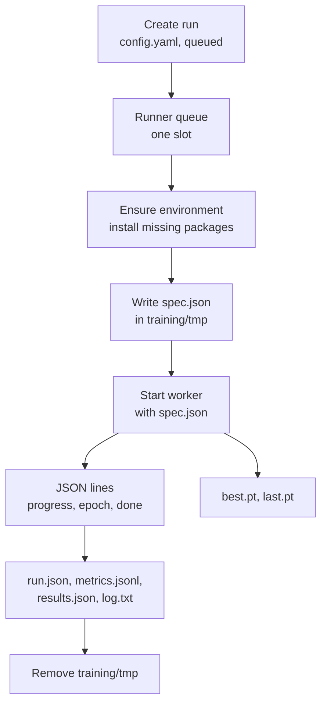

# ActiveLabel — development guide

For people who change the code. The user documentation starts at the [README](../README.md); the
architecture and flows with diagrams are in [ARCHITECTURE.md](ARCHITECTURE.md); an honest review with a
roadmap is in [ASSESSMENT.md](ASSESSMENT.md).

## Set-up

Python 3.10 or newer (CI runs 3.10 and 3.12).

```bash
git clone https://github.com/karemdm/activelabel.git
cd activelabel
python -m venv .venv
# Windows: .venv\Scripts\activate    Linux/macOS: source .venv/bin/activate
python -m pip install -e ".[dev]"
pre-commit install
```

The editable install points at the folder where you ran it. If you work in a second checkout or a git
worktree, set `PYTHONPATH` to that checkout's `src` folder before running anything, or the code of the
first checkout is used.

Run the service from your checkout with a throw-away workspace:

```bash
ACTIVELABEL_WORKSPACE=/path/to/scratch ACTIVELABEL_LANG=en activelabel serve --port 8100
```

Any free port is fine; `/docs` shows the interactive API documentation and `/openapi.json` the schema.
Never point a development server at a workspace that holds data you care about.

## Checks

| What | Command |
| --- | --- |
| Lint, docstrings, annotations | `python -m ruff check .` |
| Format | `python -m ruff format .` (CI runs `--check`) |
| Types | `python -m mypy` (reads `src`; function signatures must be typed) |
| Fast tests | `python -m pytest -q -m "not integration"` |
| FiftyOne tests | `python -m pytest -q -m integration` (starts a database of the tests' own; slow) |
| One file | `python -m pytest tests/activelabel/test_datasets.py -q` |

`pre-commit` runs ruff, mypy and the fast tests on every commit; CI (`.github/workflows/ci.yml`) runs the
same on Linux and Windows, plus the FiftyOne tests against a MongoDB service on Linux. Run the checks that
cover what you changed before you commit, and the whole suite before you open a pull request.

Training and pre-annotation tests use fake workers and a fake environment, so PyTorch is not needed to
run them. Do not start real trainings from tests.

## Project structure

```
src/activelabel/
  cli.py                 `activelabel serve`
  config.py              Settings from environment variables
  storage.py             atomic JSON read/write helpers
  labels.py              the internal label format, annotations.json, the annotations lock
  projects.py            ProjectStore (project.json, ids)
  tasks.py, tasks_store.py   project types; tasks and jobs (tasks.json)
  datasets.py            dataset versions (split, K-fold, video segments)
  jobs.py                light background jobs with progress and cancel
  preannotate.py         pre-annotation rules and run records
  fiftyone_bridge.py     the project's FiftyOne dataset, saved views, exclusions
  images/                manifest (images.json), ingest (uploads, zip, thumbnails), video (frames)
  annotations/           importers per format (coco, yolo, xmlformats, videoformats...),
                         staging, validation, conversion between project types
  curation/              measures (quality), issues and thresholds, summary
  annotate/              edit sessions: tools (fiftyone), credentials, diff
  sync/                  three-way sync engine, links, remote adapter (cvat)
  importing/             import a whole project from CVAT
  training/              catalog, config, runs, models, public_models, environment, runner, workers/
  i18n/                  en.json, pt.json
  web/                   app.py, state.py, one *_api.py router per area, pages.py,
                         templates/*.html, static/app.js and app.css
tests/activelabel/       mirrors src/activelabel; tests/helpers has shared fakes and builders
docs/                    this documentation
```

Where to start for common changes:

| Change | Look at |
| --- | --- |
| A new annotation format | `annotations/` (a parser, then `detect_format` and `parse` in `annotations/parsing.py`), tests in `tests/activelabel/annotations/` |
| A new curation issue | `curation/issues.py` (flag, threshold, `ISSUES`), the `issue.*`, `tag.*` and `threshold.*` texts in `i18n`, and `app.js` |
| A new model in the catalogue | `training/catalog.py` (data only) and, for a new kind of task, a worker in `training/workers/` and `WORKER_FILES` in `runner.py` |
| A new endpoint | the router of its area in `web/`, a test in `tests/activelabel/web/`, and the table in `docs/DESIGN.md` or the document of that area |
| A new screen text | `i18n/en.json` and `i18n/pt.json` (same key, same placeholders) |

## Conventions

- **Style.** Type hints everywhere (mypy `disallow_untyped_defs`), Google-style docstrings that tell the
  truth (ruff checks their presence and form), line length 110, readable names, small functions, no dead
  code, no duplicated helpers (look in `storage.py`, `labels.py` and the stores before writing a new one).
- **User-facing text goes through i18n.** Add the key to **both** `en.json` and `pt.json` with the same
  placeholders (`tests/activelabel/i18n` fails otherwise, and checks that every key the screen uses
  exists). Server error messages are in English. The Portuguese must have correct accents and natural
  wording.
- **Names.** The project's kind is its *type* (`Project.task` in the code); *task* and *job* are packages of
  images and their chunks; *Activities* is the card of background jobs (`activelabel.jobs`).
- **Interface.** Clean and objective; use the full width of the screen; no side menu (the horizontal step
  bar stays); responsive down to phone width; light and dark theme; accessible labels.
- **Writes to project data** go through the stores and `storage.write_json` (atomic), under the lock of the
  file being changed (`annotations_lock`, `TaskStore.locked()`, the manifest and the other stores). A
  router that changes a project's data calls `state.busy(project_id)` first.
- **A bug fix comes with a test** that fails on the old code and passes on the new one.
- **Docs travel with the code.** A change to an endpoint, a file on disk, a default or a button name
  updates the document of that area (and the Portuguese guide). The documents are generic: no
  machine-specific times, hardware, user names, accounts, local paths or personal ports.
- **Commits.** Small, one logical change each, in English, conventional style (`fix:`, `feat:`, `docs:`,
  `refactor:`, `test:`). No attribution of any tool or assistant in commits, code, docs or pull requests.
- **Pull requests.** Small and focused; say what and why; tests, ruff, mypy and docs updated. Never commit
  secrets, workspaces, `.venv` or data that is not meant to be shared.

## The training environment and the workers

Training uses packages (PyTorch, torchvision, timm, ...) that ActiveLabel itself does not depend on.



- **Environment** (`training/environment.py`). A virtual environment under `<workspace>/training/env`
  (on Windows, a short folder under the user's local application data when the path would be too long;
  the choice is recorded in `training/env.json`). The runner installs only the packages the chosen model
  needs, plus Pillow and NumPy; PyTorch comes with CUDA support when `nvidia-smi` finds an NVIDIA GPU, and
  as the CPU build otherwise. Progress goes to the run as visible steps and to `training/install.log`.
- **Device.** Chosen by the worker when it starts (CUDA, then Apple MPS, then CPU) and recorded in
  `run.json`, never in the configuration.
- **Workers** (`training/workers/`). Standalone scripts that import only the standard library and, inside
  their functions, torch and friends, so they run in an environment without ActiveLabel and their pure
  helpers can be unit-tested without torch: `classification.py`, `detection.py` (detection, instance
  segmentation and keypoints), `segmentation.py` (semantic), `predict.py` (pre-annotation) and
  `export_onnx.py`. `WORKER_FILES` in `runner.py` maps a kind of task to its script.
- **Protocol.** The runner writes `spec.json` (image paths, class indexes, labels of each part, model,
  hyperparameters) and starts `<env python> <worker> spec.json` with every cache and temporary folder
  pointed to the run's temporary folder. The worker prints one JSON object per line on stdout: `log`,
  `warning`, `progress`, `epoch` (metrics of an epoch, `best` when it is the best so far), `done` (with the
  results) or `error`; `predict.py` also prints one `prediction` per image. Lines that are not JSON go to
  the log. The runner turns events into `run.json`, `metrics.jsonl` and `results.json`.
- **Cancel** kills the whole process tree (`kill_tree`, using `psutil`). A run that was running when the
  service stopped becomes `failed` (`interrupted`) at the next start; queued runs are queued again; the
  temporary folders left by a killed process are removed.
- **Adding a model** to an existing kind is data only (`training/catalog.py`: id, label, packages, input
  size, hyperparameters, defaults). The screen builds its form from the catalogue.
- **Adding a kind of task** needs a worker, an entry in `WORKER_FILES`, metrics in `catalog.METRICS`, a
  case in `runner.build_spec`, and tests with a fake worker.

## Testing tips

- `tests/activelabel/web/conftest.py` and `tests/helpers/api_client.py` build an app with a temporary
  workspace; use them for endpoint tests rather than starting a server. `tests/helpers/` also has fakes
  for CVAT (`sync_fakes.py`, `import_fakes.py`), the training runner (`training_fakes.py`)
  and builders for images, videos and annotation files.
- Tests that need FiftyOne are marked `integration` and are left out of the fast run. They never use your own
  FiftyOne data: `tests/conftest.py` starts a `mongod` of the tests' own (FiftyOne's binary, a temporary folder,
  a free port) and sets `FIFTYONE_DATABASE_URI`, because without a URI FiftyOne attaches to any FiftyOne
  database service already running (for example the one of your ActiveLabel), whatever
  `FIFTYONE_DATABASE_DIR` says. The run stops before any test when the settings could reach another database
  (on CI the job's own MongoDB service is used).
- For manual or browser tests, start a server with `python tests/helpers/isolated_server.py --port <port>
  --workspace <folder>`: it gets its own database and workspace and refuses the ports of your own servers.
- For interface changes, run your own server on a free port and a scratch workspace, and click through
  the screens in both languages and both themes at desktop and phone widths before calling it done.
