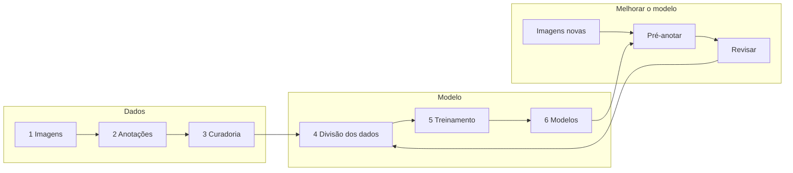

# ActiveLabel — guia em português

Conjuntos de imagens da curadoria ao modelo treinado, por etapas, numa interface web
simples (português e inglês, tema claro e escuro).

Um projeto vai das imagens ao modelo treinado em seis passos, em dois grupos: **Dados**
(imagens, anotações, curadoria) e **Modelo** (divisão dos dados, treinamento, modelos). Um
modelo treinado pode então pré-anotar imagens novas, que uma pessoa revisa no CVAT ou no
FiftyOne e devolve ao próximo treinamento.



No desenho, o modelo atual pré-anota imagens novas, uma pessoa revisa, e as imagens revisadas entram numa
nova divisão e num novo treinamento.

Os nomes de botões e abas citados aqui são os da interface em português. *Task*, *Job* e *Fold* são
a mesma palavra nos dois idiomas, como no CVAT. Os documentos em inglês
(README, `docs/`) citam a interface em inglês.

## Instalar

Python 3.10 ou mais novo.

```bash
python -m venv .venv
# Windows: .venv\Scripts\activate    Linux/macOS: source .venv/bin/activate
python -m pip install -e ".[dev]"
```

## Rodar

```bash
activelabel serve --open
```

Opções de `serve`: `--host` (padrão `127.0.0.1`), `--port` (padrão `8090`) e `--open` (abre o
navegador). Sem ativar o ambiente, use o lançador do repositório, que roda o Python da pasta
`.venv` ao lado dele: `activelabel.cmd serve --open` (Windows) ou `./activelabel.sh serve --open`
(Linux, macOS). A interface abre em `http://127.0.0.1:8090`. O serviço não tem login: mantenha o
host padrão `127.0.0.1`, a não ser numa rede confiável.

## Passo a passo

### Criar o projeto

Na lista de projetos, *Novo projeto*: nome, descrição e **tipo** (classificação, detecção,
segmentação ou pontos-chave). O número do projeto é automático. As classes são opcionais;
podem vir dos arquivos de anotação. Um projeto que já existe no CVAT pode
ser importado em vez de criado (veja [IMPORT.md](IMPORT.md), em inglês). A página do projeto
mostra uma barra compacta com os seis passos, em dois grupos; cada passo tem um marcador (feito,
pede atenção, em andamento) e o seu estado.

No ActiveLabel, *task* é um pacote de imagens, como no CVAT; o tipo do projeto é o que a
interface chama de *Tipo*.

### Grupo Dados

**1. Imagens.** Duas abas:

- *Galeria*: a grade de imagens, com filtros por task e por job.
- *Tasks e jobs*: as tasks do projeto (cada envio de imagens, ou cada vídeo, é uma task),
  divididas em jobs do tamanho que você escolher, como no CVAT. Em *Nova task* solte
  arquivos, uma pasta, um .zip ou um vídeo. Os arquivos são guardados sem alteração (o tipo da imagem vem do conteúdo, não da extensão); imagens
  idênticas entram uma só vez; arquivos ilegíveis aparecem na lista com o motivo. Detalhes:
  [TASKS.md](TASKS.md) e [VIDEO.md](VIDEO.md).

**2. Anotações** (opcional). Cinco abas:

- *Resumo*: o que o projeto já tem, em blocos (imagens anotadas, anotações, classes com anotação,
  a revisar) e as classes mais frequentes, com busca e *Ver todas*.
- *Pré-anotar*: um modelo salvo (ou um modelo público) sugere anotações para as imagens de uma
  task (veja o fim deste guia e [PREANNOTATE.md](PREANNOTATE.md)).
- *CVAT*: sincroniza as anotações com o CVAT nos dois sentidos. *Comparar com o CVAT* mostra o
  que mudou de cada lado, você revisa (e resolve os conflitos) e confirma com *Aplicar a
  sincronização*; nada muda antes disso ([ANNOTATION.md](ANNOTATION.md) e [SYNC.md](SYNC.md)).
  Se o projeto vinculado foi apagado no CVAT, a tela avisa; use *Desvincular* e compare de novo
  para criar um projeto novo.
- *FiftyOne*: escolha quais imagens e use *Enviar para FiftyOne* para editá-las no App do
  FiftyOne; depois *Trazer anotações de volta*, revise as diferenças e *Aplicar alterações* (ou
  *Descartar estas alterações*).
- *Importar anotações*: solte os arquivos de anotação (ou um .zip). O formato é detectado
  (COCO JSON, YOLO txt com `data.yaml`/`classes.txt`, Pascal VOC XML, XML do CVAT para
  imagens ou vídeo, MOT, JSON do Label Studio, pastas de classes), os arquivos são casados
  com as imagens e um relatório (que ocupa o lugar da área de soltar) mostra o que foi encontrado e os
  problemas. Rótulos sem a forma do tipo do projeto são avisados e ficam de fora. Nada é importado
  até você escolher: *Importar*, *Mudar o tipo para {tipo} e importar* (quando as anotações
  são de outro tipo), *Converter para {tipo} e importar* (por exemplo contornos em caixas) ou
  *Descartar*. Se o projeto já tem anotações, escolha também *Mesclar* ou *Substituir*.
  Anotações feitas para um vídeo inteiro vão para uma task de vídeo, casadas pelo número do
  quadro ([VIDEO.md](VIDEO.md)).

**3. Curadoria.** *Analisar imagens* mede brilho, contraste, nitidez, tamanho e um hash
perceptual de cada imagem. Os filtros por problema (borradas, escuras, claras, baixo contraste,
pequenas, proporção estranha, tons de cinza, quase duplicatas) mostram as imagens apontadas;
*Selecionar sugeridas* marca as que provavelmente vale excluir. Selecione e use *Excluir
selecionadas* (reversível: aba *Excluídas*, botão *Restaurar selecionadas*) ou *Apagar
definitivamente* (pede confirmação). Os limites de cada problema ficam em *Limites* e
mudam sem medir de novo; *Zerar análise* esquece as medidas, os problemas apontados e os grupos
de quase duplicatas (imagens, exclusões e anotações ficam). *Abrir no FiftyOne* abre o mesmo
filtro no App do FiftyOne; imagens marcadas com a tag `exclude` lá voltam com *Trazer exclusões
do FiftyOne*. Arquivos corrompidos não chegam até aqui: são rejeitados no envio.

### Grupo Modelo

**4. Divisão dos dados.** Cria uma *versão do dataset*: partes de treino, validação e teste
(ou K dobras mais uma parte de teste). Quadros do mesmo vídeo e quase duplicadas ficam juntos,
e as classes são distribuídas de forma equilibrada. Escolha as tasks, as porcentagens (números
que somam 100; para treinar é preciso ter validação), imagens de fundo, modo de vídeos e a
semente; a prévia mostra os avisos antes de salvar. Rótulos que o modelo não conseguiria usar ficam de
fora, com aviso, e uma versão cujo treino ou validação ficaria vazio é recusada. Cada versão tem
*Treinar com esta versão*. Detalhes: [DATASETS.md](DATASETS.md).

**5. Treinamento.** Escolha a versão do dataset, o modelo do catálogo e como começar
(transferência de aprendizado, ajuste fino ou do zero), em execução única, busca em grade ou
todas as dobras. Há curvas ao vivo e avaliação na parte de teste. Estão disponíveis
classificação, detecção, segmentação semântica, segmentação por instância (Mask R-CNN) e
pontos-chave (torchvision); os modelos YOLO/Ultralytics ainda não estão disponíveis e ficam
escondidos na interface. Os pacotes necessários são instalados sob demanda, num ambiente
separado. *Reproduzir* repete um treino com a mesma configuração. Detalhes:
[TRAINING.md](TRAINING.md).

**6. Modelos.** Use *Salvar como modelo* num treino concluído, compare os modelos, escolha o
modelo atual (*Tornar atual*), baixe os pesos e exporte para ONNX (classificação e segmentação
semântica). *Adicionar modelo público* inclui um modelo já treinado no COCO, sem treinar nada.

### Pré-anotar imagens novas com um modelo

1. Em *Imagens*, aba *Tasks e jobs*, crie uma *Nova task* com as imagens novas.
2. Em *Anotações*, aba *Pré-anotar*: escolha o modelo (o atual, por padrão), a task, quais
   imagens (sem anotação, ou pré-anotadas e ainda não revisadas) e a confiança mínima (de 0,05
   a 0,95; a tela propõe 0,5 para classificação e 0,3 para detecção e pontos-chave). Inicie.
   Imagens ilegíveis são contadas e puladas. Funciona para classificação, detecção,
   pontos-chave e segmentação (as máscaras viram polígonos). No cartão de um modelo em *Modelos*,
   *Pré-anotar com este* abre esta aba com o modelo escolhido.
3. Em *Para revisar*, use *Revisar no CVAT* ou *Revisar no FiftyOne*, corrija o que for
   preciso e traga de volta (sincronização com o CVAT, ou sessão de edição do FiftyOne). Ou
   escolha *Aceitar como estão*.
4. Crie uma nova versão em *Divisão dos dados* e treine de novo. Pré-anotações não revisadas
   nunca entram numa versão do dataset.

Sem nenhum treino ainda, dá para começar com um **modelo público**: em *Modelos*, *Adicionar
modelo público*, escolha um modelo treinado no COCO (detecção ou pontos-chave) e diga qual
categoria dele vira cada classe do projeto (a tela sugere quando os nomes batem). Ele aparece
como mais um modelo e pode ser usado em *Pré-anotar* (o modelo salvo ou o modelo público).
Os pesos são baixados a cada uso, numa pasta temporária apagada no fim; é preciso internet.

### Atividades

As tarefas demoradas (análise, envio, sincronização, treinamento, exportação, pré-anotação)
aparecem num cartão pequeno no canto inferior direito da página do projeto, com progresso,
*Parar* e *Ver resultado*. Ele pode ser minimizado ou fechado; as atividades concluídas
ficam no histórico. Só um processo pesado (treinamento, exportação ou pré-anotação) roda de
cada vez; os outros esperam na fila.

Mais: [ARCHITECTURE.md](ARCHITECTURE.md) (arquitetura, modelo de dados e fluxos, em inglês),
[DESIGN.md](DESIGN.md) (dados em disco e API HTTP, em inglês),
[DEVELOPMENT.md](DEVELOPMENT.md) (guia de quem desenvolve, em inglês) e
[FUTURE-LLM.md](FUTURE-LLM.md) (uso planejado de modelos de linguagem, em inglês).

## Configuração

| Variável | Padrão | O que faz |
| --- | --- | --- |
| `ACTIVELABEL_WORKSPACE` | `~/.activelabel` | Onde ficam projetos, imagens e anotações |
| `ACTIVELABEL_LANG` | `en` | Idioma padrão da interface (`en` ou `pt`) |
| `ACTIVELABEL_IMPORT_ROOT` | (desligado) | Pasta desta máquina cujas subpastas podem ser importadas pelo caminho (só pela API, sem botão na interface) |

O endereço e o usuário do CVAT ficam em `<workspace>/tools.json`; senhas e tokens só no chaveiro
do sistema.

## Licença

Apache License 2.0, veja o arquivo [LICENSE](../LICENSE).
