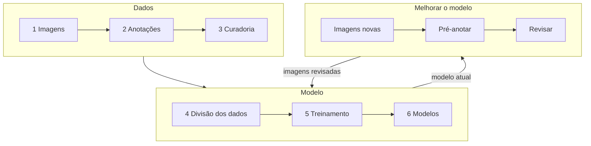

# ActiveLabel — guia em português

Conjuntos de imagens da curadoria ao modelo treinado, por etapas, numa interface web
simples (português e inglês, tema claro e escuro).

Um projeto vai das imagens ao modelo treinado em seis passos, em dois grupos: **Dados**
(imagens, anotações, curadoria) e **Modelo** (divisão dos dados, treinamento, modelos). Um
modelo treinado pode então pré-anotar imagens novas, que uma pessoa revisa no CVAT ou no
FiftyOne e devolve ao próximo treinamento.



No desenho, o modelo atual pré-anota imagens novas, uma pessoa revisa, e as imagens revisadas entram numa
nova divisão e num novo treinamento.

Os nomes de botões e abas citados aqui são os da interface em português. *Task*, *Job* e *Fold* são
a mesma palavra nos dois idiomas, como no CVAT. Os documentos em inglês
(README, `docs/`) citam a interface em inglês.

## Instalar

Python 3.10 ou mais novo.

```bash
python -m venv .venv
# Windows: .venv\Scripts\activate    Linux/macOS: source .venv/bin/activate
python -m pip install -e .              # o núcleo
python -m pip install -e ".[fiftyone]"  # o núcleo mais o FiftyOne (".[all]" é igual; ".[dev]" o inclui)
python -m pip install -e ".[dev]"       # para desenvolver: FiftyOne mais as ferramentas de teste e lint
```

O núcleo é uma instalação leve: projetos, imagens, medidas de curadoria e o mapa de similaridade,
anotações, tasks, vídeos, sincronização com o CVAT, datasets, treinamento e pré-anotação. O extra
acrescenta o FiftyOne:

| Instalação | O que traz |
| --- | --- |
| `pip install activelabel` | tudo o que está acima; os pacotes de treino não fazem parte dela, vão para um ambiente de treino separado, instalado no primeiro uso (docs/TRAINING.md) |
| `pip install "activelabel[fiftyone]"` (ou `[all]`) | também o App do FiftyOne, a ferramenta de anotação do FiftyOne, a importação de projetos do CVAT (lidos com o leitor de CVAT do FiftyOne) e o mapa de similaridade no App |

Sem o FiftyOne, o que depende do extra responde HTTP 501 `fiftyone_not_installed` com o comando de
instalação, e o resto funciona. *GET /api/features* mostra o que está instalado e quanto espaço o ambiente
de treino ocupa; *DELETE /api/training/environment* remove esse ambiente (o próximo treino instala de novo o
que precisar).

## Rodar

```bash
activelabel serve --open
```

Opções de `serve`: `--host` (padrão `127.0.0.1`), `--port` (padrão `8090`) e `--open` (abre o
navegador). Sem ativar o ambiente, use o lançador do repositório, que roda o Python da pasta
`.venv` ao lado dele: `activelabel.cmd serve --open` (Windows) ou `./activelabel.sh serve --open`
(Linux, macOS). A interface abre em `http://127.0.0.1:8090`. O serviço não tem login: mantenha o
host padrão `127.0.0.1`, a não ser numa rede confiável.

## Passo a passo

### Criar o projeto

Na lista de projetos, *Novo projeto*: nome, descrição e **tipo** (classificação, detecção,
segmentação ou pontos-chave). O número do projeto é automático. As classes são opcionais;
podem vir dos arquivos de anotação, ser digitadas (Enter ou vírgula adiciona uma classe) ou coladas como lista. Um projeto que já existe no CVAT pode
ser importado em vez de criado (veja [IMPORT.md](IMPORT.md), em inglês). A página do projeto
mostra uma barra compacta com os seis passos, em dois grupos; cada passo tem um marcador (feito,
pede atenção, em andamento) e o seu estado. Dentro de um projeto a cor de destaque é a do seu tipo
(por exemplo verde-azulado na classificação, violeta na detecção), sempre junto do ícone e do nome do tipo;
a página inicial continua azul.

No ActiveLabel, *task* é um pacote de imagens, como no CVAT; o tipo do projeto é o que a
interface chama de *Tipo*.

### Grupo Dados

**1. Imagens.** Duas abas:

- *Galeria*: a grade de imagens, com filtros por task e por job.
- *Tasks e jobs*: as tasks do projeto (cada envio de imagens, ou cada vídeo, é uma task),
  divididas em jobs do tamanho que você escolher, como no CVAT. Em *Nova task* solte
  arquivos, uma pasta, um .zip ou um vídeo. Os arquivos são guardados sem alteração (o tipo da imagem vem do conteúdo, não da extensão); imagens
  idênticas entram uma só vez; arquivos ilegíveis aparecem na lista com o motivo. Cada task e cada job
  tem um menu para abrir: *Editar no FiftyOne* e *Abrir no CVAT*; o item que ainda não pode ser usado
  fica desativado, com o motivo escrito embaixo (por exemplo, projeto não vinculado ao CVAT). O FiftyOne
  não edita pontos-chave: num projeto de pontos-chave o menu oferece *Ver no FiftyOne*, e a edição é feita
  no CVAT. Se um envio for interrompido no meio, a task fica fechada e marcada como incompleta; as imagens
  que faltam vão numa task nova. Detalhes: [TASKS.md](TASKS.md) e [VIDEO.md](VIDEO.md).

**2. Anotações** (opcional). Cinco abas. *Abrir no CVAT*, na aba CVAT, abre o projeto vinculado (ou a task ou o job escolhido) e *Editar no FiftyOne*, na aba
FiftyOne, abre o App para editar; quando o projeto ainda não pode ser aberto no CVAT (sem configuração, sem vínculo ou ainda fora do CVAT), a aba diz o motivo em uma linha, no lugar do botão. As edições voltam: por *Comparar com o CVAT* e por uma sessão de edição do FiftyOne.

- *Resumo*: o que o projeto já tem, em blocos (imagens anotadas, anotações, classes com anotação,
  a revisar) e as classes mais frequentes, com busca e *Ver todas*.
- *Pré-anotar*: um modelo salvo (ou um modelo público) sugere anotações para as imagens de uma
  task (veja o fim deste guia e [PREANNOTATE.md](PREANNOTATE.md)).
- *CVAT* (a revisão no CVAT é feita só por aqui): sincroniza as anotações com o CVAT nos dois sentidos. *Comparar com o CVAT* mostra o
  que mudou de cada lado, você revisa (e resolve os conflitos) e confirma com *Aplicar a
  sincronização*; nada muda antes disso ([ANNOTATION.md](ANNOTATION.md) e [SYNC.md](SYNC.md)).
  Se o projeto vinculado foi apagado no CVAT, a tela avisa; use *Desvincular* e compare de novo
  para criar um projeto novo. Só as diferenças são enviadas; uma classe renomeada no CVAT é renomeada
  aqui, uma task renomeada de um lado é renomeada do outro, esqueletos do CVAT viram poses e o que não pode ser convertido é contado
  na revisão. Descartar uma comparação apaga o plano, para que outra aba não o aplique.
- *FiftyOne*: *Editar no FiftyOne* envia as imagens (todas, ou as que você escolher em *Escolher imagens*) e abre o App
  do FiftyOne, que mostra só o `ground_truth`. Para uma imagem só, o caminho curto: na galeria de *Imagens*,
  clique na imagem e em *Editar no FiftyOne*; o App abre direto nela. Depois de editar, *Enviar ao ActiveLabel*
  (no alto da janela da imagem) leva as edições ao projeto na hora, quando nada precisa de um olhar, e diz o que
  mudou; senão abre a revisão. *Revisar antes de aplicar*, na aba FiftyOne, faz sempre abrir a revisão, e uma
  sessão aplicada tem *Desfazer*. Ao clicar numa imagem, a janela já abre na aba *Annotate*, pronta
  para editar só com o mouse: clique numa caixa para selecioná-la, arraste-a para mover, arraste um canto ou um
  ponto do polígono para ajustar, troque a classe em *label* à direita, apague com a tecla *Delete* (vários de uma vez com a lixeira no alto da janela, *Apagar rótulos*, que se
  desfaz com a lixeira com seta ao lado) e desfaça
  com as setas ao lado de *Create* (ou Ctrl+Z); depois *Revisar e aplicar* lê as alterações e mostra as diferenças, e você usa *Aplicar alterações* (ou
  *Descartar estas alterações*). O esquema de rótulos que o App exige para editar é gravado pelo
  ActiveLabel; só as imagens editadas no FiftyOne trazem a versão de lá. Geometrias inválidas que voltam
  do FiftyOne são listadas como problema, nunca gravadas em silêncio.
  Uma caixa ou polígono movido para longe no FiftyOne conta como *editado* (não como adicionado e removido), e as
  tags das imagens e dos rótulos criadas no FiftyOne voltam, aparecem na revisão e ficam guardadas no projeto.

- *Importar anotações*: solte os arquivos de anotação (ou um .zip). O formato é detectado
  (COCO JSON, YOLO txt com `data.yaml`/`classes.txt`, Pascal VOC XML, XML do CVAT para
  imagens ou vídeo, MOT, pastas de classes), os arquivos são casados
  com as imagens e um relatório (que ocupa o lugar da área de soltar) mostra o que foi encontrado e os
  problemas. Rótulos sem a forma do tipo do projeto são avisados e ficam de fora. Nada é importado
  até você escolher: *Importar*, *Mudar o tipo para {tipo} e importar* (quando as anotações
  são de outro tipo), *Converter para {tipo} e importar* (por exemplo contornos em caixas) ou
  *Descartar*. Se o projeto já tem anotações, escolha também *Mesclar* ou *Substituir*.
  Anotações feitas para um vídeo inteiro vão para uma task de vídeo, casadas pelo número do
  quadro ([VIDEO.md](VIDEO.md)).

Antes de qualquer mudança que apague ou reescreva anotações em bloco (importação que substitui,
aplicação do FiftyOne ou do CVAT, classe renomeada no CVAT, restauração), o ActiveLabel faz uma cópia de
segurança das anotações; ficam as 20 mais recentes. Uma imagem revisada sem nenhum objeto (uma imagem
de fundo, por exemplo) não conta como anotada: aparece à parte, como "N sem objetos".

**3. Curadoria.** *Analisar imagens* mede brilho, contraste, nitidez, tamanho e um hash
perceptual de cada imagem. Os filtros por problema (borradas, escuras, claras, baixo contraste,
pequenas, proporção estranha, tons de cinza, quase duplicatas) mostram as imagens apontadas;
*Selecionar sugeridas* marca as que provavelmente vale excluir. Selecione e use *Excluir
selecionadas* (reversível: aba *Excluídas*, botão *Restaurar selecionadas*) ou *Apagar
definitivamente* (pede confirmação). Os limites de cada problema ficam em *Limites* e
mudam sem medir de novo; *Zerar análise* esquece as medidas, os problemas apontados e os grupos
de quase duplicatas (imagens, exclusões e anotações ficam). *Abrir no FiftyOne* abre o mesmo
filtro no App do FiftyOne; imagens marcadas com a tag `exclude` lá voltam com *Trazer exclusões
do FiftyOne*. Arquivos corrompidos não chegam até aqui: são rejeitados no envio. O *Mapa de
semelhança* agrupa as imagens parecidas: *Calcular mapa* lê cada imagem ativa com uma rede pequena
do ImageNet no ambiente de treino (instalado no primeiro uso, na mesma fila dos treinos), coloca as
imagens num mapa 2-D (t-SNE, ou PCA em conjuntos muito pequenos ou grandes) e as divide em grupos
(k-means), cada um com seu tamanho e sua imagem típica. *Reagrupar* (com progresso e Cancelar) agrupa o mesmo
mapa de novo sem recalculá-lo: *Automático*, um *Número de grupos* à sua escolha ou *Grupos de tamanho livre*
(HDBSCAN, com o *Menor grupo*); neste, as imagens que não cabem em grupo nenhum aparecem numa cor neutra e têm
um filtro próprio, *Sem grupo*, acima da grade. O mesmo mapa abre no App do FiftyOne (painel
Embeddings, execução `activelabel_similarity`, cores pelo campo `similarity_group`).

A *Unicidade* dá a cada imagem uma nota de 0 (tem uma quase gêmea) a 1 (a mais diferente), a partir do mapa:
*Calcular unicidade* precisa do mapa pronto (o botão diz isso enquanto ele não existe), entra na fila das
atividades pesadas, mostra o andamento e tem Cancelar. Com as notas, a grade pode ser ordenada por elas
(*Mais únicas primeiro* ou *Mais repetidas primeiro*) e filtrada para as imagens com unicidade *abaixo de* um
valor, o que acha as quase repetidas; a nota aparece em cada cartão enquanto um dos dois está ligado e no
detalhe da imagem. Um aviso diz quando as imagens mudaram desde as notas.

### Grupo Modelo

**4. Divisão dos dados.** Cria uma *versão do dataset*: partes de treino, validação e teste
(ou K folds mais uma parte de teste). Quadros do mesmo vídeo e quase duplicadas ficam juntos,
e as classes são distribuídas de forma equilibrada; uma classe rara entra em todas as partes antes de as
proporções serem aplicadas. Escolha as tasks, as porcentagens (números que somam 100; para treinar é
preciso ter validação), imagens de fundo e, em *Avançado*, a semente, o modo de vídeos e o intervalo de
segurança. Um vídeo fica inteiro numa parte quando dá; senão (*Dividir em trechos distantes quando
necessário*) é cortado em trechos espalhados ao longo do vídeo, e o interruptor *Descartar quadros na
fronteira entre partes do mesmo vídeo* (ligado por padrão) tira os quadros vizinhos dos trechos de
validação e teste; desligado, as métricas ficam otimistas.

A prévia mostra os avisos antes de salvar. A tabela de classes começa pelas mais raras, marca com um
ícone o zero de uma classe ausente de uma parte e mostra a fatia de cada classe em cada parte; o aviso de
classe ausente diz quantas imagens têm a classe e se daria para colocá-la em todas as partes (com outra
semente ou outras proporções). Rótulos que o modelo não conseguiria usar ficam de fora, com aviso, e uma
versão cujo treino ou validação ficaria vazio é recusada. Se os rótulos mudarem depois de criada a
versão, o cartão avisa "Rótulos mudaram depois desta versão" e oferece *Nova versão a partir desta*.
Cada versão tem *Treinar com esta versão*. Detalhes: [DATASETS.md](DATASETS.md).

**5. Treinamento.** Escolha a versão do dataset, o modelo do catálogo e como começar
(transferência de aprendizado, ajuste fino ou do zero), em execução única, busca em grade (valores
separados por ponto e vírgula, com vírgula decimal: `0,01; 0,001`) ou todos os folds. Há curvas ao vivo (perda, métricas e taxa de aprendizado) e avaliação na parte de teste. O diálogo escolhe o modelo em três campos: a família, a arquitetura (ou a geração, no YOLO: YOLO26, YOLO11, YOLOv8) e o tamanho ou a variante (n, s, m, l, x; ResNet 18 a 152...); o que o modelo aprende vem do tipo do projeto. Trocar só o tamanho mantém os valores que você mudou. Estão disponíveis
classificação, detecção, segmentação semântica, segmentação por instância (Mask R-CNN) e
pontos-chave (torchvision); os modelos YOLO/Ultralytics (licença AGPL-3.0) aparecem quando você lê e aceita a
licença no próprio diálogo (*Ler e aceitar a licença…*; veja *Licences* em TRAINING.md, em inglês). No diálogo do treino você escolhe também o *Dispositivo* (*Automático*, *CPU*,
*GPU n* ou *GPU da Apple (MPS)*), como a foto vira a entrada quadrada (*Esticar*, *Letterbox* ou *Corte
central*, o mesmo na avaliação, na pré-anotação e no ONNX), o agendamento da taxa de aprendizado
(*Cosseno*, *Em degraus*, *Ciclo único*, *Platô*) com épocas de aquecimento (nunca mais que as épocas do treino; a
paciência da parada antecipada também fica abaixo delas), a precisão mista (numa GPU
CUDA) e as *Técnicas de aumento de dados* do nível escolhido; mudar uma técnica passa o nível para
*Personalizado*. Trocar de modelo mantém os valores que você mudou, quando o novo modelo os aceita, e
diz o que mudou. Se a GPU ficar sem memória, o lote é reduzido à metade até caber. Os pacotes
necessários são instalados sob demanda, em versões fixas e testadas, num ambiente separado. *Reproduzir* repete um treino com a mesma configuração; um treino que falhou ou foi cancelado pode ser continuado do último ponto de controle com *Retomar*. Os avisos e as falhas de um treino aparecem na interface, no idioma escolhido, e o cartão do treino mostra *O que o treino usou* (dispositivo, lote, precisão). Detalhes:
[TRAINING.md](TRAINING.md).

**6. Modelos.** Use *Salvar como modelo* num treino concluído, marque os modelos que quer comparar (ou
*Selecionar todos*; os treinos concluídos se comparam do mesmo jeito em Treinamento), escolha o
modelo atual (*Tornar atual*), baixe os pesos e exporte para ONNX (classificação e segmentação
semântica). *Adicionar modelo público* inclui um modelo já treinado no COCO, sem treinar nada (projetos
de detecção e de pontos-chave; nos outros tipos o botão não aparece).

### Pré-anotar imagens novas com um modelo

1. Em *Imagens*, aba *Tasks e jobs*, crie uma *Nova task* com as imagens novas.
2. Em *Anotações*, aba *Pré-anotar*: escolha o modelo (o atual, por padrão), a task, quais
   imagens (sem anotação, ou pré-anotadas e ainda não revisadas) e o dispositivo. Em *Ajustes da
   pré-anotação* (recolhido, com um resumo do que mudou) dá para escolher só algumas classes do modelo
   e ajustar os parâmetros do tipo de modelo: confiança mínima (padrão 0,5 em classificação e 0,25 nos
   demais), IoU do NMS, máximo de objetos, tamanho mínimo, limiar da máscara e outros, cada um com seu
   padrão e "Restaurar". Inicie. No *Histórico*, *Repetir com estes ajustes* preenche o formulário com os
   ajustes de uma execução.
   Imagens ilegíveis são contadas e puladas. Funciona para classificação, detecção,
   pontos-chave e segmentação (as máscaras viram polígonos). No cartão de um modelo em *Modelos*,
   *Pré-anotar com este* abre esta aba com o modelo escolhido.
3. Em *Para revisar*, use *Revisar no CVAT* ou *Revisar no FiftyOne*, corrija o que for
   preciso e traga de volta (sincronização com o CVAT, ou sessão de edição do FiftyOne). Ou
   escolha *Aceitar como estão*.
4. Crie uma nova versão em *Divisão dos dados* e treine de novo. Pré-anotações não revisadas
   nunca entram numa versão do dataset.

Sem nenhum treino ainda, dá para começar com um **modelo público**: em *Modelos*, *Adicionar
modelo público*, escolha um modelo treinado no COCO (detecção ou pontos-chave) e diga qual
categoria dele vira cada classe do projeto (a tela sugere quando os nomes batem, também em português:
`gato` para `cat`, `cachorro` para `dog`). Ele aparece
como mais um modelo e pode ser usado em *Pré-anotar* (o modelo salvo ou o modelo público).
Os pesos são baixados a cada uso, numa pasta temporária apagada no fim; é preciso internet.

### Atividades

As tarefas demoradas (análise, envio, sincronização, treinamento, exportação, pré-anotação)
aparecem numa pequena pílula no canto inferior direito da página do projeto; ela abre um cartão com
progresso, *Parar* e *Ver resultado*. Um sucesso some sozinho; uma falha fica vermelha até ser aberta ou
dispensada no ×; as atividades concluídas ficam no histórico. Trabalho pesado (treinamento, pré-anotação,
exportação, análise de curadoria, extração de vídeo) roda um por vez em cada dispositivo (CPU, cada GPU);
os outros esperam numa fila global, que sobrevive a um reinício. O botão *Fila* na barra superior, em
qualquer página (atalho Alt+Q), mostra o trabalho pesado de todos os projetos que roda ou espera, com a
posição na fila, o progresso e *Cancelar*.

Mais: [ARCHITECTURE.md](ARCHITECTURE.md) (arquitetura, modelo de dados e fluxos, em inglês),
[DESIGN.md](DESIGN.md) (dados em disco e API HTTP, em inglês),
[DEVELOPMENT.md](DEVELOPMENT.md) (guia de quem desenvolve, em inglês),
[RELEASING.md](../RELEASING.md) (como uma versão é publicada, em inglês) e
[FUTURE-LLM.md](FUTURE-LLM.md) (uso planejado de modelos de linguagem, em inglês).

## Configuração

| Variável | Padrão | O que faz |
| --- | --- | --- |
| `ACTIVELABEL_WORKSPACE` | `~/.activelabel` | Onde ficam projetos, imagens e anotações |
| `ACTIVELABEL_LANG` | `en` | Idioma padrão da interface (`en` ou `pt`) |
| `ACTIVELABEL_IMPORT_ROOT` | (desligado) | Pasta desta máquina cujas subpastas podem ser importadas pelo caminho (só pela API, sem botão na interface) |
| `ACTIVELABEL_ALLOWED_HOSTS` | (nenhum) | Outros nomes, separados por vírgula, em que o servidor responde, por exemplo o nome desta máquina na rede local ao servir com `--host` |
| `ACTIVELABEL_QUEUE_CPU` | `1` | Trabalhos que podem rodar ao mesmo tempo na faixa do processador da fila de trabalho (vazio, inválido ou menor que 1: 1) |
| `ACTIVELABEL_QUEUE_GPU` | `1` | Trabalhos que podem rodar ao mesmo tempo em cada faixa de GPU (`cuda:N`, `mps`) da fila de trabalho (vazio, inválido ou menor que 1: 1) |

O endereço e o usuário do CVAT ficam em `<workspace>/tools.json`; senhas e tokens só no chaveiro
do sistema.

O servidor não tem login; por isso só atende chamadas feitas ao próprio endereço (`127.0.0.1`,
`localhost`, `[::1]` ou o endereço de `--host`, com a porta dele), e uma alteração vinda de uma página do
navegador só é aceita se vier das páginas dele mesmo. O resto recebe HTTP 403 (`host_not_allowed`,
`origin_not_allowed`). Um script (`curl`, Python `requests`) não envia `Origin` nem `Referer` e funciona
normalmente usando o endereço do servidor, por exemplo `http://127.0.0.1:8090/api/projects`. Para usar
outro nome, inclua-o em `ACTIVELABEL_ALLOWED_HOSTS`.

## Licença

Apache License 2.0, veja o arquivo [LICENSE](../LICENSE).
